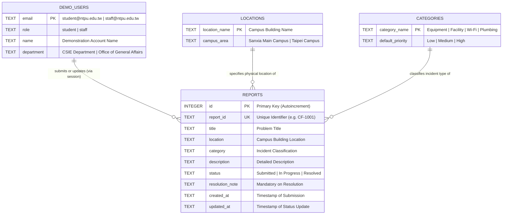
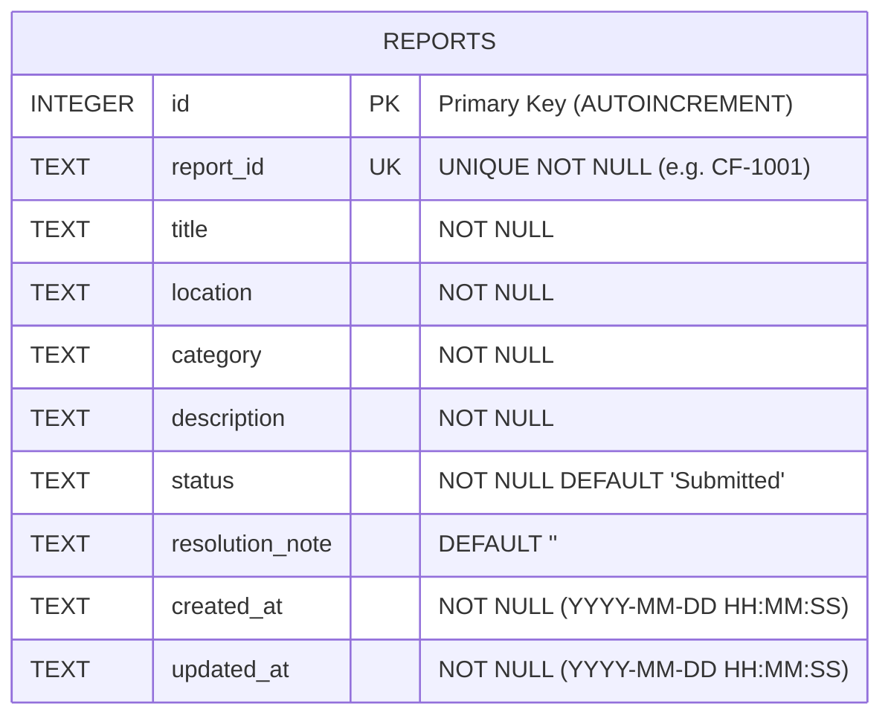
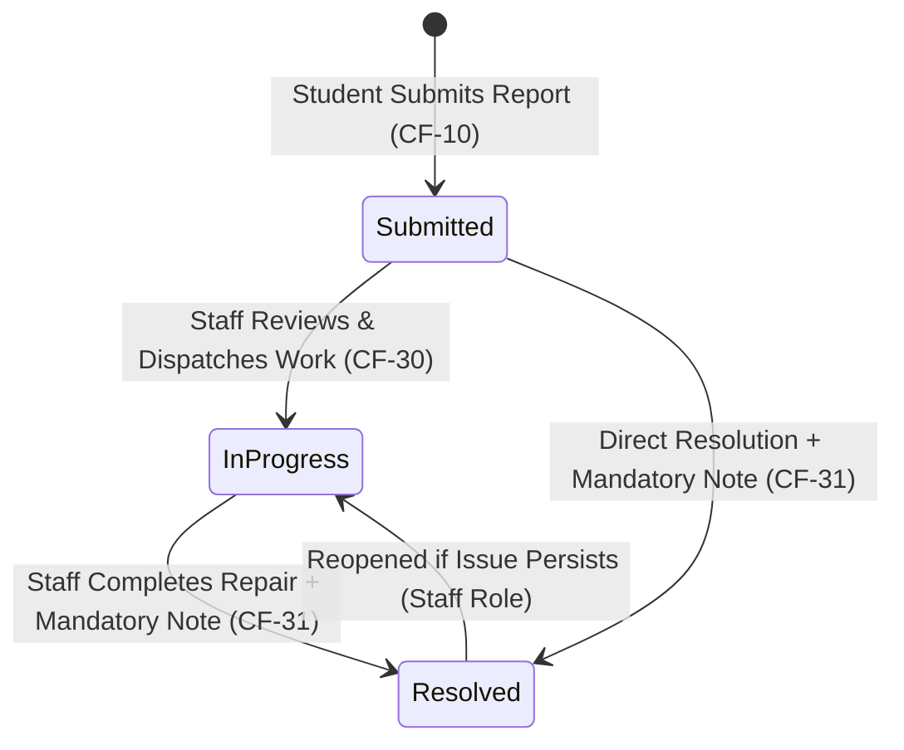

# CampusFix - Database Entity-Relationship Diagram (ERD) & Schema Specification
**National Taipei University / Software Engineering (Team 04)**  
**Storage Engine**: SQLite 3 (ACID Compliant) | **Database File**: `campusfix.db`

---

## 1. Conceptual Entity-Relationship Diagram (Mermaid)

The diagram below visualizes the persistent `REPORTS` table alongside the domain and lookup entities (`DEMO_USERS`, `LOCATIONS`, `CATEGORIES`):



---

## 2. Physical SQLite Schema (Data Definition Language)

The physical table is created idempotently on server startup in [`database.py`](file:///C:/Users/phone/.gemini/antigravity/scratch/campusfix/database.py):

```sql
CREATE TABLE IF NOT EXISTS reports (
    id INTEGER PRIMARY KEY AUTOINCREMENT,
    report_id TEXT UNIQUE NOT NULL,
    title TEXT NOT NULL,
    location TEXT NOT NULL,
    category TEXT NOT NULL,
    description TEXT NOT NULL,
    status TEXT NOT NULL DEFAULT 'Submitted',
    resolution_note TEXT DEFAULT '',
    created_at TEXT NOT NULL,
    updated_at TEXT NOT NULL
);
```

### Physical ER Diagram



---

## 3. Data Dictionary & Field Specifications

| Column Name | SQLite Type | Constraints | Description & Agile Traceability |
| :--- | :--- | :--- | :--- |
| `id` | `INTEGER` | `PRIMARY KEY AUTOINCREMENT` | Internal database surrogate key for fast index lookups and row addressing. |
| `report_id` | `TEXT` | `UNIQUE NOT NULL` | **CF-12**: Human-readable incident identifier formatted as `CF-1001`, `CF-1002`. Monotonically assigned upon insert. |
| `title` | `TEXT` | `NOT NULL` | **CF-10, CF-11**: Concise problem summary. Validated to prevent empty strings or whitespace-only bypasses. |
| `location` | `TEXT` | `NOT NULL` | **CF-10, CF-22**: Campus building/facility. Used for location filtering dropdown with combined `AND` logic. |
| `category` | `TEXT` | `NOT NULL` | **CF-10**: Problem type (`Classroom Equipment`, `Damaged Facilities`, `Wi-Fi Failures`, `Plumbing & Restroom`, `Other`). |
| `description` | `TEXT` | `NOT NULL` | **CF-10, CF-21**: Detailed description. Indexed and queried case-insensitively using `LOWER(description) LIKE ?`. |
| `status` | `TEXT` | `NOT NULL DEFAULT 'Submitted'` | **CF-14, CF-30**: Lifecycle state. Permitted values strictly: `'Submitted'`, `'In Progress'`, `'Resolved'`. |
| `resolution_note`| `TEXT` | `DEFAULT ''` | **CF-31**: Official staff repair notes. Mandatory (non-empty) when transitioning status to `'Resolved'`. |
| `created_at` | `TEXT` | `NOT NULL` | **CF-13**: ISO timestamp recorded upon submission (`YYYY-MM-DD HH:MM:SS`). |
| `updated_at` | `TEXT` | `NOT NULL` | **CF-30**: ISO timestamp updated whenever staff modifies status or appends notes. |

---

## 4. Lifecycle State Transitions


