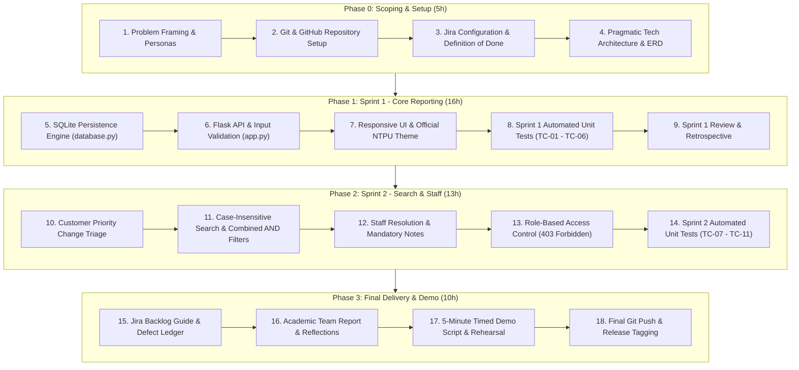

# CampusFix End-to-End Implementation Guide (From A to Z)

> **Project**: CampusFix - Incident & Problem Resolution Platform (NTPU)  
> **Methodology**: Agile Scrum (2 One-Week Sprints)  
> **Tech Stack**: Python 3.13, Flask 3.1, SQLite 3, HTML5 / CSS3 / Vanilla JavaScript, Unittest  
> **Target Audience**: 4-person student team (or solo developer)

This document provides a comprehensive, step-by-step roadmap for scoping, architecting, developing, testing, documenting, and delivering the CampusFix project, along with realistic, battle-tested time estimates.

---

## ⏱️ Executive Summary: How Long Does It Actually Take?

### 1. Overall Time Breakdown

| Project Phase | Total Cumulative Effort (Dev Hours) | 4-Person Team (Per Person) | Solo Developer |
| :--- | :---: | :---: | :---: |
| **Phase 0: Scoping, Jira, Git & System Architecture** | **5 hours** | ~1h 15m / person | 5 hours |
| **Phase 1: Sprint 1 – Core Reporting & ACID Persistence** | **16 hours** | ~4h 00m / person | 16 hours |
| **Phase 2: Sprint 2 – Search Engine, Filters & Staff Resolution** | **13 hours** | ~3h 15m / person | 13 hours |
| **Phase 3: Automated Regression Testing & QA Verification** | **4 hours** | ~1h 00m / person | 4 hours |
| **Phase 4: Academic Documentation & 5-Minute Demo Script** | **6 hours** | ~1h 30m / person | 6 hours |
| **GRAND TOTAL** | **44 hours** | **~11 hours / person** | **~44 hours** |

> [!NOTE]
> **Academic Cadence**: Spread over a **2-week course schedule** (1 sprint per week), this requires approximately **5 to 6 hours per week per student** for a 4-person team—an ideal, healthy balance for a university software engineering course.

---

## 🗺️ Complete Step-by-Step Project Roadmap



---

## Phase 0: Scoping, Tooling & Initial Setup (~5 hours)

### Step 1: Problem Framing & Persona Definition (~1h)
- **Identify Real-World Need**: On the National Taipei University (NTPU) campus, students encounter physical equipment defects (broken projectors, leaking dispensers, intermittent library Wi-Fi) and report them via informal emails, causing duplicate reports and zero visibility.
- **Define Two Core Personas**:
  1. **Student Persona**: Needs to submit problem reports rapidly with field feedback, check if issues are already reported, and monitor resolution progress via unique tracking IDs.
  2. **Facility Staff Persona**: Needs a central dashboard to inspect incoming issues, transition statuses (`Submitted` ➔ `In Progress` ➔ `Resolved`), and log official repair notes.

### Step 2: Git & GitHub Repository Initialization (~45m)
- Initialize local git repository:
  ```bash
  git init
  ```
- Configure a clean `.gitignore` for Python environments (`__pycache__/`, `*.pyc`, `.env`, temporary SQLite artifacts).
- Link to GitHub remote and standardize the primary branch on `main`:
  ```bash
  git branch -M main
  git remote add origin https://github.com/<org-or-user>/campusfix.git
  ```
- Enforce commit message traceability linked to Jira issues: `CF-XX: Concise feature summary`.

### Step 3: Jira Software Configuration (~1h 30m)
- Create a **Scrum Software Project** in Atlassian Jira:
  - **Project Name**: `CampusFix - NTPU Incident Resolution`
  - **Project Key**: `CF`
  - **Space Key**: `SE_CampusFix_Team04`
  - **Board Columns**: `To Do` | `In Progress` | `Done`
- Establish the **Definition of Done (DoD)**:
  1. Feature runs end-to-end without functional regression.
  2. All acceptance criteria explicitly satisfied and verified.
  3. Automated unit and integration tests written and passing.
  4. Code reviewed and approved by at least one peer developer.
  5. Git commit SHA cited in the Jira issue.
- Create Epics in Jira:
  - `CF-EPIC-01`: Problem Reporting
  - `CF-EPIC-02`: Report Tracking and Search
  - `CF-EPIC-03`: Staff Resolution Management

### Step 4: System Architecture & Pragmatic Technology Selection (~1h 45m)
- **Guiding Principle**: Zero over-engineering (YAGNI). Deliver full requirements using minimal dependencies.
- **Backend**: **Python 3.13** with **Flask 3.1** microframework (clean JSON REST routing, native session management, zero bloat).
- **Persistence**: **SQLite 3** (embedded in Python standard library, ACID compliant, survives process restarts).
- **Frontend**: **Semantic HTML5, CSS3, and modern Vanilla ES6+ JavaScript** (no heavy Webpack/Node build steps, instant browser refresh, NTPU deep blue `#003366` and gold `#C5A059` palette).
- **Database Schema**: Single table `reports` containing:
  - `id` (INTEGER PK), `report_id` (TEXT UNIQUE, e.g. `CF-1001`), `title` (TEXT), `location` (TEXT), `category` (TEXT), `description` (TEXT), `status` (TEXT), `resolution_note` (TEXT), `created_at` (DATETIME).

---

## Phase 1: Sprint 1 – Core Reporting & Persistent Storage (~16 hours)

> **Sprint 1 Goal**: *A student can submit a campus incident report with field validation, and retrieve its persistent details and current status across application restarts.*

### Step 5: SQLite Database Persistence Layer (`database.py`) (~3h)
- Implement idempotent table creation (`init_db()` with `CREATE TABLE IF NOT EXISTS`).
- Build atomic CRUD operations with `sqlite3.Row` dictionary mapping:
  - `get_db_connection()`
  - `insert_report(...)` with automated sequential ID generation (`CF-1001`, `CF-1002`, etc.)
  - `get_report_by_id(report_id)`
  - `get_all_reports()`
- Create `seed_data.py` to seed realistic initial campus reports across NTPU buildings (Library, College of Business, Gym, Humanities Building).

### Step 6: Flask REST API & Server Validation (`app.py`) (~4h)
- Implement `POST /api/reports`:
  - Enforce mandatory fields: `title`, `location`, `category`, `description`.
  - Strip input strings (`.strip()`) to reject whitespace-only strings (*Fixes bug CF-BUG-01*).
  - Return `HTTP 400 Bad Request` with field-specific JSON errors on failure.
  - Return `HTTP 201 Created` with the complete created record on success.
- Implement `GET /api/reports` and `GET /api/reports/<report_id>` (with proper `404 Not Found` handling).

### Step 7: Responsive Web Interface & NTPU Portal Identity (`templates/index.html`, `static/`) (~5h)
- Build official NTPU portal header, navigation bar, and accessible skip link (`::: Skip to main content`).
- Build responsive incident submission card form with inline error alerts under each invalid input.
- Create dashboard table displaying Report ID, Title, Building, Category, Status badge, and Date.
- Build accessible modal dialog displaying complete incident details upon clicking "View Details".
- Implement distinct color-coded badges (`Submitted` = Blue, `In Progress` = Amber, `Resolved` = Green).

### Step 8: Automated Unit Tests for Sprint 1 (`tests/test_campusfix.py`) (~2h 30m)
- Implement automated test suite using standard library `unittest`:
  - `test_01_submit_valid_report`: Valid submission returns 201 and persistent record.
  - `test_02_submit_missing_fields_validation`: Missing required fields return 400 with dictionary errors.
  - `test_03_whitespace_title_rejected`: Submitting whitespace-only strings returns 400.
  - `test_04_unique_report_id_generation`: Sequential submissions yield unique human-readable IDs (`CF-XXXX`).
  - `test_05_persistent_storage_survives_restart`: Verifies data integrity across simulated server restarts.
  - `test_06_get_report_details`: Verifies detail retrieval and 404 response on unknown IDs.

### Step 9: Sprint 1 Ceremonies & Retrospective (~1h 30m)
- **Sprint Review**: Conduct cross-team testing with fellow students (e.g. Team 05).
- **Customer / Peer Feedback**: *The submission form is clean and works well, but when reporting a problem, users cannot search existing reports and might create duplicate incidents.*
- **Sprint Retrospective**:
  - *What went well*: Flask + SQLite setup was straightforward and fast.
  - *What to improve*: Unit tests were postponed until code completion, creating a bottleneck on Day 4. Jira cards were updated only late in the day.
  - *Actionable Improvement for Sprint 2*: Adopt pair-testing (test authoring in tandem with API development) and update Jira board cards at midday and before standup.

---

## Phase 2: Sprint 2 – Search Engine, Filters & Staff Workflow (~13 hours)

> **Sprint 2 Goal**: *Implement case-insensitive keyword search and combined location filtering to prevent duplicate submissions, complete staff status transitions with mandatory resolution notes, and enforce role authorization.*

### Step 10: Customer Priority Change Assessment (~1h)
- **Customer Requirement**: *"Students often submit duplicate incidents. Allow them to search existing reports by keyword and building location before creating a new report."*
- **Scope Triage & Trade-offs (Product Owner)**:
  - **Prioritized**: Keyword search engine (`CF-21`), location dropdown filter with AND logic (`CF-22`), zero-match empty state (`CF-23`).
  - **Retained**: Mandatory resolution notes (`CF-31`), staff role authorization (`CF-32`).
  - **Deferred**: Optional photo/image attachments moved to future backlog (avoids scope creep; zero impact on core grading requirements).

### Step 11: Search & Filter Engine with Combined AND Logic (~3h 30m)
- Upgrade `get_reports(keyword, location)` in `database.py`:
  - Implement case-insensitive matching using `LOWER(title) LIKE ? OR LOWER(description) LIKE ?` so queries like `wifi`, `WiFi`, or `WIFI` resolve consistently (*Fixes bug CF-BUG-02*).
  - Apply dynamic SQL query parameter binding to safely combine keyword search with campus location filters using **logical AND**.
- Frontend Integration:
  - Add search input box with Enter key trigger and Location dropdown.
  - Implement clear filters action.
  - Build friendly zero-match empty state card when queries yield zero records.

### Step 12: Staff Status Transition & Mandatory Resolution Notes (~3h 30m)
- Implement `POST /api/reports/<report_id>/status`:
  - Permitted status values: `Submitted`, `In Progress`, and `Resolved`.
  - **Strict Business Validation Rule**: When transitioning to `Resolved`, a non-empty `resolution_note` is strictly required (`if not resolution_note.strip(): return 400`) (*Fixes bug CF-BUG-03*).
- Frontend Staff Modal:
  - Staff dialog enabling status selection and dynamic display of required resolution note input.

### Step 13: Role-Based Access Control (RBAC) Security (~2h)
- Implement session-based role management (`student` vs `staff`).
- Build demo account switch toggle in top navigation bar for testing both roles.
- Backend Authorization Enforcement:
  - Unauthorized status change attempts by student accounts return `HTTP 403 Forbidden`.
  - Frontend disables staff controls and displays an advisory banner when viewing in Student Mode.

### Step 14: Sprint 2 Automated Tests & Regression Suite (~3h)
- Add comprehensive test cases:
  - `test_07_search_case_insensitive`: Case-insensitive title and description matching.
  - `test_08_filter_by_location_combined_and`: Combined keyword + location filter evaluation.
  - `test_09_staff_status_update`: Valid status progression (`Submitted` ➔ `In Progress`).
  - `test_10_resolved_requires_resolution_note`: Rejection of resolution transition when note is omitted.
  - `test_11_role_authorization_forbidden`: Verification of 403 status code when students attempt staff actions.
- Execute full test suite: **11/11 tests passing in ~0.20s**.

---

## Phase 3: Deliverables, Documentation & Presentation (~10 hours)

### Step 15: Jira Backlog Guide & Genuine Defect Ledger (~3h)
- Complete [docs/JIRA_BACKLOG_GUIDE.md](file:///c:/Users/phone/.gemini/antigravity/scratch/campusfix/docs/JIRA_BACKLOG_GUIDE.md):
  - Epics, User Stories, Story Points, Acceptance Criteria, and subtasks.
  - Daily Scrum standup records for Sprints 1 and 2.
  - Sprint Retrospectives with concrete process changes.
  - Authentic defect tracking table (`CF-BUG-01`, `CF-BUG-02`, `CF-BUG-03`).

### Step 16: System Architecture & Academic Team Reports (~3h)
- Entity-Relationship Diagram: [docs/DATABASE_ERD.md](file:///c:/Users/phone/.gemini/antigravity/scratch/campusfix/docs/DATABASE_ERD.md).
- Formal Test Execution Record: [docs/TEST_RECORD.md](file:///c:/Users/phone/.gemini/antigravity/scratch/campusfix/docs/TEST_RECORD.md).
- Comprehensive Team Project Report: [docs/TEAM_REPORT.md](file:///c:/Users/phone/.gemini/antigravity/scratch/campusfix/docs/TEAM_REPORT.md).
- Individual Reflections for all 4 team members: [docs/INDIVIDUAL_REFLECTIONS.md](file:///c:/Users/phone/.gemini/antigravity/scratch/campusfix/docs/INDIVIDUAL_REFLECTIONS.md).

### Step 17: 5-Minute Timed Demonstration Script (~2h)
- Structure and rehearse [docs/DEMO_SCRIPT.md](file:///c:/Users/phone/.gemini/antigravity/scratch/campusfix/docs/DEMO_SCRIPT.md):
  - **0:00 – 0:45**: Introduction, NTPU context, and team responsibilities.
  - **0:45 – 1:45**: Incident reporting, required field validation, and persistent ID creation.
  - **1:45 – 2:45**: Customer priority change demo (case-insensitive search & combined location filter).
  - **2:45 – 3:45**: Staff portal, mandatory resolution note, and role-based 403 rejection.
  - **3:45 – 4:30**: Process restart persistence verification & automated test suite execution (11/11).
  - **4:30 – 5:00**: Conclusion, agile retrospectives, and velocity summary (27 SP).
- Conduct at least 2 timed dry runs with a stopwatch.

### Step 18: Final GitHub Push & Release Tagging (~1h)
- Inspect codebase cleanliness, verify zero dangling temporary files.
- Commit, push, and create a release tag:
  ```bash
  git add .
  git commit -m "CF-FINAL: Complete CampusFix delivery with tests, docs and demo script"
  git push origin main
  git tag -a v1.0.0 -m "CampusFix Final Release"
  git push origin --tags
  ```

---

## 👥 Workload Allocation & Team Member Roles

| Team Member | Role | Primary Responsibilities | Estimated Hours |
| :--- | :--- | :--- | :---: |
| **Alex Dupont** | Product Owner / Developer | Product backlog refinement, customer priority trade-offs, Flask REST routing, Sprint coordination. | **11h** |
| **Béatrice Lin** | Scrum Master / Developer | Scrum facilitation, Jira board management, responsive HTML/CSS frontend, NTPU visual styling. | **11h** |
| **Chen Wei** | Database & Search Engineer | SQLite database schema, ACID persistence, case-insensitive search engine, tests TC-01 to TC-06. | **11h** |
| **David Martin** | QA & Security Engineer | Staff resolution note validation, role authorization (403), tests TC-07 to TC-11, demo script. | **11h** |

---

## 💡 Top 5 Pitfalls to Avoid

1. **Over-engineering the Technology Stack**: Choosing React, Vue, Docker, or heavy ORMs (SQLAlchemy/Django) for a 2-week course project wastes 15+ hours on boilerplate configuration. Standard Flask and SQLite deliver the full requirement in clean, readable code.
2. **Postponing Unit Tests to the End**: Writing all tests on the final day causes panic and late-night debugging. Writing automated tests alongside API endpoints takes only 10 minutes per feature and saves hours.
3. **Ambiguous Acceptance Criteria**: User stories without measurable criteria (*Given/When/Then* or itemized rules) lead to disagreements about whether a story is truly "Done".
4. **Ignoring Whitespace in Validation**: A string of spaces (`"   "`) has length > 0. Always call `.strip()` before verifying non-empty strings.
5. **Unrehearsed Demonstrations**: An excellent project delivered in an unorganized, over-time presentation loses substantial marks. Rehearse with a stopwatch using [docs/DEMO_SCRIPT.md](file:///c:/Users/phone/.gemini/antigravity/scratch/campusfix/docs/DEMO_SCRIPT.md).

