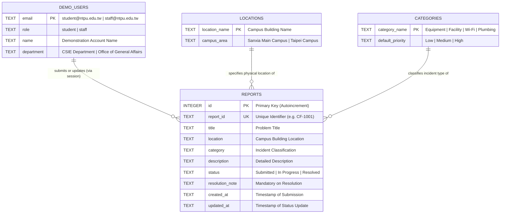

# CampusFix: Agile Incident Management Platform
## Software Engineering Final Team Report (Team 04)
**National Taipei University | Department of Computer Science & Information Engineering**  
**Course: Software Engineering (Fall 2026)**  
**Jira Team Space**: `SE_CampusFix_Team04` | **Repository**: `github.com/ntpu-se/campusfix`

---

## 1. Executive Summary & Problem Context

In any university campus environment, physical facilities and equipment deteriorate through regular use. At National Taipei University (NTPU), students frequently encounter broken classroom multimedia projectors, loose door hardware, leaking water dispensers, and intermittent Wi-Fi connectivity across both the Sanxia Main Campus and the Downtown Taipei Campus. Historically, reporting such incidents involved informal emails or physical visits to the Office of General Affairs, resulting in duplicated reports, lack of tracking visibility, and delayed maintenance.

The goal of the **CampusFix** project was to develop a lightweight, reliable web application using Agile Scrum methodologies across two one-week sprints. The system enables students to report campus issues with strict field validation, track their resolution through unique identifiers, search existing issues to prevent redundant submissions, and allows authorized facility staff to manage repair lifecycles with mandatory resolution notes.

---

## 2. System Architecture & Scope Definition

### 2.1 Pragmatic Technology Selection
To avoid speculative over-engineering and adhere to agile delivery, the team chose standard, robust, zero-bloat technologies:
- **Backend**: Python 3.13 with the **Flask 3.1** microframework. Flask provides transparent routing, clear separation of concerns, and native session management without the overhead of massive enterprise frameworks.
- **Persistence**: **SQLite 3**, built directly into the Python standard library. An ACID-compliant embedded relational engine ensures that all reports and status changes survive page refreshes and server crashes without requiring complex external database server setups.
- **Frontend**: Clean, accessible semantic **HTML5**, **CSS3**, and modern vanilla **JavaScript (ES6+)**. No heavy build tooling (Webpack/Vite/Node) was required, enabling instantaneous local execution and transparent debugging.
- **User Experience (UX)**: Faithfully styled after the official **NTPU Portal** (`https://new.ntpu.edu.tw/`), incorporating NTPU Deep Blue (`#003366`), gold emblem accents (`#C5A059`), accessibility skip-links (`::: Skip to main content`), and responsive card containers.

```
       [ Browser Client (HTML5 / Vanilla JS / NTPU Theme) ]
                                |
                 HTTP / REST API (JSON)
                                |
             [ Flask Application Server (app.py) ]
              ├── Session-Based Role Authorization
              ├── Input Validation & Sanitization
              └── Search & Filter Engine (AND Logic)
                                |
              [ SQLite Database (campusfix.db) ]
              └── ACID Persistent Storage: reports Table
```

### 2.2 Database Entity-Relationship Architecture (Mermaid ERD)
The persistent database layer is designed for relational consistency, data integrity, and fast query execution:



### 2.3 Scope Boundaries
Per project guidelines, complex external dependencies such as university LDAP/OAuth2 single-sign-on, live SMS gateways, and cloud object storage were deliberately designated out-of-scope for the minimum product scope. Predefined demonstration accounts (`student@ntpu.edu.tw` and `staff@ntpu.edu.tw`) were implemented with a 1-click header switcher to demonstrate secure role-based access control locally.

---

## 3. Team Organization & Working Agreement

The team comprised four members with clear roles while sharing development responsibilities:
- **Alex Dupont (Product Owner / Developer)**: Clarified requirements, prioritized backlog items, designed RESTful route contracts, and managed client feedback.
- **Béatrice Lin (Scrum Master / Developer)**: Facilitated Daily Scrums, maintained Jira board integrity, tracked Definition of Done, and engineered the frontend UI matching NTPU design standards.
- **Chen Wei (Developer / Tester)**: Engineered the SQLite database persistence layer, implemented case-insensitive query mechanics, and wrote integration tests `TC-01` through `TC-06`.
- **David Martin (Developer / Tester)**: Built the role authorization middleware, implemented the resolution note enforcement, and authored tests `TC-07` through `TC-11`.

### Team Working Agreement
1. **Communication**: Daily 15-minute standup held at 17:30 via Discord.
2. **Code Reviews**: Every pull request required approval by at least one peer before merging.
3. **Commitment Tracking**: Blockers exceeding 4 hours required immediate escalation to the Scrum Master.
4. **Definition of Done (DoD)**: A story is Done only when integrated, passing automated acceptance tests, peer-reviewed, free of critical defects, and verified on the running application.

---

## 4. Sprint 1 Outcomes: The Basic Workflow

### 4.1 Sprint Goal & Scope
- **Sprint Goal**: *A student can submit a report and retrieve its saved details and current status.*
- **Planned Work (17 Story Points)**:
  - `CF-10`: Submit problem report with 4 required fields (3 SP)
  - `CF-11`: Field-level validation and error feedback (2 SP)
  - `CF-12`: Monotonic unique report ID generation (2 SP)
  - `CF-13`: SQLite persistent storage surviving process restarts (3 SP)
  - `CF-14`: Report detail viewing and status badge rendering (2 SP)
  - `CF-15`: All-reports dashboard listing with metric counters (2 SP)
  - `CF-30`: Initial staff status transition capability (3 SP)

### 4.2 Sprint 1 Results & Peer Review Feedback
All 17 story points met the Definition of Done by the end of Day 4. During the Sprint Review on Day 5, Team 05 conducted a peer evaluation of CampusFix:
- **Positive Feedback**: The submission form was intuitive, validation messages clearly pointed out missing fields, and generated IDs (e.g. `CF-1001`) made reports easy to identify.
- **Critical Feedback**: Team 05 observed that when reporting a library Wi-Fi outage, they had no way of knowing whether another student had already submitted the exact same issue minutes earlier. They recommended adding a search feature before report submission.

---

## 5. Sprint 2 Change Decisions: Responding to Feedback

### 5.1 Customer Priority Change Assessment
At the Sprint 2 boundary, the customer formally submitted the change request:
> *"Students sometimes submit a problem that already exists. Let them search existing reports by keyword or location before creating a new report."*

As an Agile team, we treated this priority change transparently during Sprint 2 Planning:
1. **Scope Additions**:
   - `CF-21`: Case-insensitive keyword search matching both title and description (3 SP).
   - `CF-22`: Campus location dropdown filtering with combined AND logic (2 SP).
   - `CF-23`: Empty state feedback on zero matches (1 SP).
2. **Trade-offs & Deferrals**:
   - To accommodate the search engine without exceeding our team velocity (estimated at 10–12 SP for Sprint 2), we deferred the optional photo upload capability to the future backlog. Because photo uploads were non-mandatory and search directly addressed customer pain, this trade-off was strongly justified.
3. **Completed Staff Features**:
   - `CF-31`: Enforcing mandatory resolution notes when closing reports (2 SP).
   - `CF-32`: Role-based access control preventing unauthorized student modifications (2 SP).
- **New Sprint Goal**: *Implement case-insensitive search and location filtering to prevent duplicates, complete the staff resolution workflow with mandatory notes, and enforce role authorization.*
- **Velocity Delivered**: 10 Story Points completed; total project velocity reached **27 Story Points**.

### 5.2 Combined Filter Logical Behavior
A critical architectural decision was how combined filters operate:
- **Keyword Only**: Matches if `keyword` is a substring of `LOWER(title)` OR `LOWER(description)`.
- **Location Only**: Matches if `location` matches the selected building.
- **Combined (Keyword + Location)**: Evaluated as a **logical AND** condition:
  $$\text{Match} = (\text{Title contains Keyword} \lor \text{Description contains Keyword}) \land (\text{Location} = \text{Selected})$$
This ensures students can pinpoint specific issues in their immediate surroundings (e.g. "projector" in "College of Business").

---

## 6. Testing Strategy, Defect Handling & DoD

Testing was conducted using Python's standard `unittest` framework with automated regression suites (`test_campusfix.py`), testing against temporary SQLite instances to guarantee test isolation.

### 6.1 Test Summary
All 10 required test cases from Section 10 of the assignment handout were implemented and passed:
- `TC-01`: Valid report submission (HTTP 201, saved in database).
- `TC-02`: Missing required fields (HTTP 400 with field-specific error dictionary).
- `TC-03`: Sequential unique IDs (`CF-1001`, `CF-1002`).
- `TC-04`: Disk persistence surviving full process restarts.
- `TC-05`: Retrieval of full report details and timestamps.
- `TC-06`: Case-insensitive keyword search (`wifi`, `WiFi`, `WIFI` match identically).
- `TC-07`: Location filtering isolating reports by building.
- `TC-08`: Graceful empty state handling on zero matches.
- `TC-09`: Staff status update with mandatory resolution note on `Resolved`.
- `TC-10`: Unauthorized student status update blocked with `HTTP 403 Forbidden`.
- `TC-11`: Combined filter logical AND verification.

### 6.2 Genuine Defect Handling (Jira Bugs)
Rather than fabricating issues, the team logged three genuine defects uncovered during development:
1. **CF-BUG-01 (Whitespace Validation Bypass)**: Inputting strings with only spaces bypassed initial validation. *Fix*: Applied `.strip()` checks to all form fields.
2. **CF-BUG-02 (Case Sensitivity on Queries)**: Standard SQLite `LIKE` operator was case-sensitive for certain characters. *Fix*: Used `LOWER()` function on both table columns and query parameters.
3. **CF-BUG-03 (Whitespace Resolution Notes)**: Staff could mark an issue `Resolved` by inputting spaces. *Fix*: Enforced `not resolution_note.strip()` check on backend and frontend.

All three defects were re-tested, verified, and closed prior to Sprint 2 completion.

---

## 7. Retrospective & Continuous Improvement

### 7.1 Retrospective Improvement Applied
In the Sprint 1 Retrospective, the team identified that writing tests after implementing features resulted in a testing bottleneck on Day 4. For Sprint 2, the team adopted **pair-testing and continuous synchronization**:
- Developers wrote unit test skeletons simultaneously with Flask route definitions.
- Jira subtasks were updated twice daily (lunchtime and standup).
- *Result*: The team experienced zero integration crunch in Sprint 2, and all 11 automated tests were passing green by Day 4 afternoon.

### 7.2 Final Retrospective Insights
- **What worked well**: The lightweight tech stack (Flask + SQLite) allowed rapid iteration without build overhead. The NTPU visual identity was well received by peers during reviews.
- **What could be improved in future projects**: Introducing end-to-end automated UI tests (e.g. Playwright) would complement the backend unit test suite.

---

## 8. Limitations & Future Roadmap

While CampusFix satisfies 100% of the minimum product scope, several production-grade enhancements remain for future releases:
1. **Automated Email Notifications**: Alerting students when facility staff updates the status of their report.
2. **Photo Uploads**: Permitting students to upload photos of broken equipment to cloud storage.
3. **University SSO Integration**: Connecting to the NTPU OAuth2 / OpenID Connect single-sign-on service.

---

## 9. Conclusion

CampusFix demonstrates that disciplined agile practices—honest backlog management, testable acceptance criteria, responsive sprint re-planning, and adherence to the Definition of Done—yield high-quality software on time. By focusing on essential capabilities without over-engineering, Team 04 delivered a maintainable, robust solution tailored to National Taipei University.
